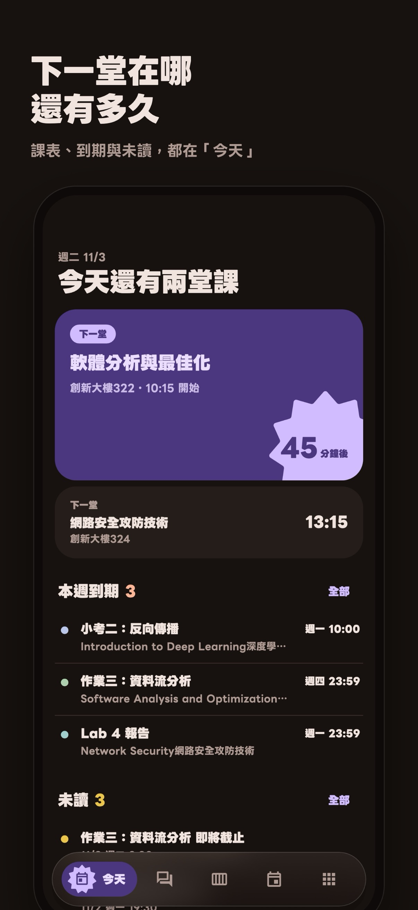
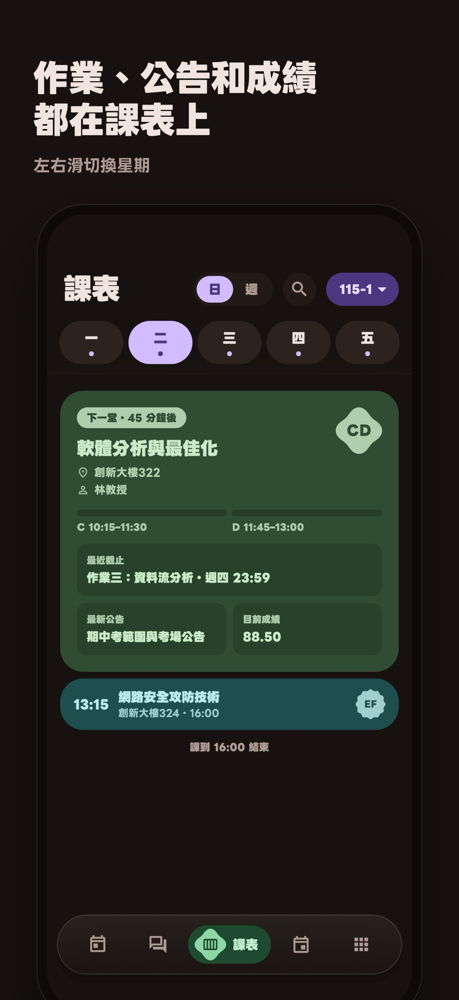
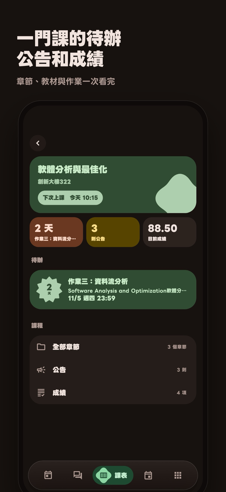
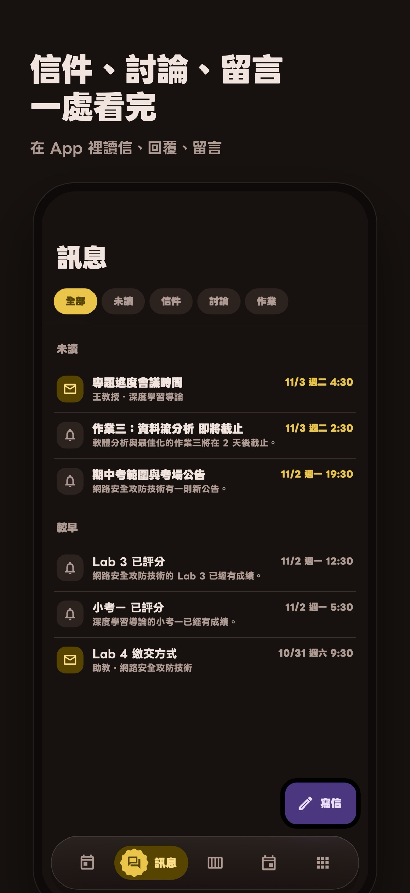
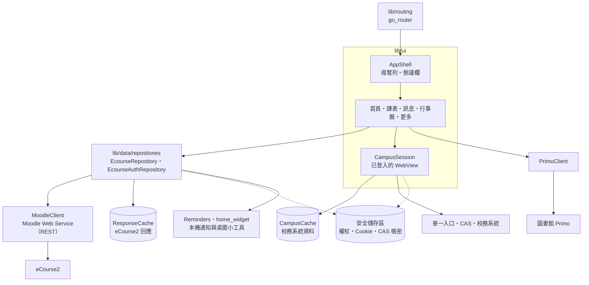
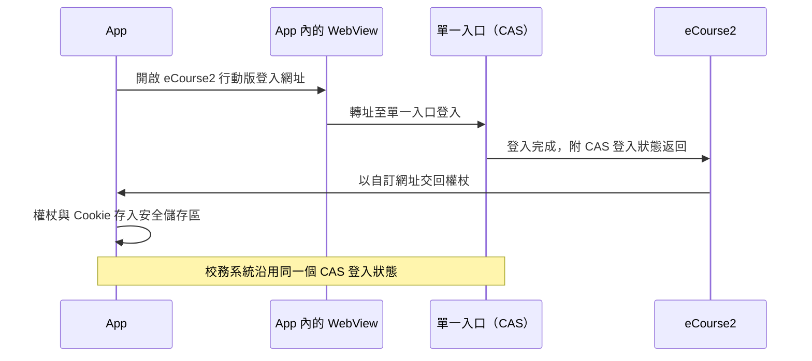

<p align="center">
  
</p>

<h1 align="center">TAT CCU</h1>

<p align="center">
  <strong>國立中正大學的課表、eCourse2 與校務系統</strong><br>
  iOS・iPadOS・macOS・Android・Windows
</p>

<p align="center">
  <a href="https://github.com/KoukeNeko/TAT-CCU/releases/latest"></a>
  <a href="https://github.com/KoukeNeko/TAT-CCU/releases"></a>
  
  
  <a href="https://play.google.com/store/apps/details?id=io.github.koukeneko.tat_ccu"></a>
  
  <a href="https://github.com/KoukeNeko/TAT-CCU/stargazers"></a>
</p>

<p align="center">
  <a href="https://apps.apple.com/app/id6825362775"></a>
  <a href="https://apps.apple.com/app/id6825362775"></a>
  <a href="https://play.google.com/store/apps/details?id=io.github.koukeneko.tat_ccu"></a>
</p>

<p align="center">
  <a href="#下載與安裝">下載與安裝</a>
  · <a href="#功能">功能</a>
  · <a href="PRIVACY.md">隱私權政策</a>
</p>

TAT CCU 整合 eCourse2、單一入口與各校務系統的資料。首頁顯示當日課程、本週到期的作業與小考，
以及未讀的公告與信件。以單一入口登入一次即可使用 eCourse2 與校務系統。

**本 App 為學生自行開發的非官方 App，與國立中正大學沒有隸屬關係。** 開發者不設伺服器，資料僅在
裝置與學校系統之間傳遞。

## 畫面

<p align="center">
  
  
  
  
  
</p>

<p align="center">
  
</p>

## 功能

### 首頁

下一堂課的教室與倒數、當日其餘課程、本週到期的作業與小考，以及未讀的公告與信件。

### 課表

每週課程，手機依日切換，寬螢幕顯示整週。每堂課顯示最近截止、最新公告與目前成績。

### eCourse2 課程

章節、教材、作業、討論區、成績與缺曠課。支援作業進度（開放、繳交、截止、評分）與討論區留言。

### 訊息

eCourse2 的信件、公告與討論。支援閱讀、回覆與撰寫信件。

### 行事曆

學校行事曆（期中考週、放假、加退選）與作業、小考的截止日，顯示於同一張月曆。

### 校務系統

成績查詢、圖書館館藏與借閱、請假、付款與所得、自學空間 QR Code 與空位、在學證明書、活動報名、
公車動態與倒數。

### 小工具與提醒

桌面小工具顯示下一堂課與到期項目。上課與截止前的提醒由裝置排程。

### 示範帳號

不需中正帳號即可試用。示範資料與個人帳號分開。

## 隱私

- 登入資料（eCourse2 權杖、校務系統的登入狀態，以及選擇自動登入時的學號與密碼）存放於系統的安全
  儲存區（iOS 與 macOS 為鑰匙圈，不同步至 iCloud；Android 為 Keystore）。
- 讀取過的課表、公告與成績暫存於裝置，可於「設定 > 已存資料」查看與刪除；登出時一併刪除。
- App 僅連線至學校系統，以及使用中功能所需的服務（圖書館查詢、公車動態、「關於」頁的 GitHub 貢獻者清單），資料不經過開發者。
- 沒有廣告、分析或追蹤。

完整內容見 [隱私權政策](PRIVACY.md)。

## 下載與安裝

**macOS**：以 [Homebrew](https://brew.sh) 安裝，以 `brew upgrade` 更新。

```bash
brew install --cask koukeneko/tap/tat-ccu
```

或從 [最新版本](https://github.com/KoukeNeko/TAT-CCU/releases/latest) 下載
`TAT-CCU-x.y.z-macos.zip`（已經 Apple 公證）。

**Android**：從 [Google Play](https://play.google.com/store/apps/details?id=io.github.koukeneko.tat_ccu) 安裝，由 Google Play 更新。
或從 [最新版本](https://github.com/KoukeNeko/TAT-CCU/releases/latest) 下載
`TAT-CCU-x.y.z-android.apk`。各版本附 `SHA256SUMS` 供核對。

**Windows**：以 [Scoop](https://scoop.sh) 安裝，以 `scoop update tat-ccu` 更新。

```bash
scoop bucket add koukeneko https://github.com/KoukeNeko/scoop-bucket
scoop install koukeneko/tat-ccu
```

或從 [最新版本](https://github.com/KoukeNeko/TAT-CCU/releases/latest) 下載
`TAT-CCU-x.y.z-windows-x64.zip`，解壓縮後執行 `tat_ccu.exe`。尚未簽章，首次開啟時 SmartScreen 會提示。

**iPhone 與 iPad**：準備上架 App Store。

## 支援的裝置

- iPhone、iPad：iOS 17 以上，含 iPhone Duo 的內外螢幕
- Mac：macOS 12 以上
- Android 手機與平板，含摺疊機
- Windows：Windows 10 以上（x64），不含桌面小工具與點名掃描
- 介面語言：繁體中文、English、日本語

版面依裝置調整：手機使用底部浮動導覽列；iPad 與 Mac 的寬視窗使用側邊欄，清單與內容並排；
摺疊機與 iPhone Duo 沿摺線分頁。

---

## 技術說明

### 架構



eCourse2 的課程、作業、訊息與行事曆透過 Moodle Web Service 取得；無 API 的校務系統，於已登入的
WebView 中讀取頁面。兩者的資料皆快取於裝置，開啟時先顯示快取，再向學校更新。

### 登入流程



App 採用 eCourse2 的行動版登入流程：於 App 內的 WebView 完成單一入口（CAS）登入後，eCourse2 以
自訂網址交回權杖。各校務系統沿用同一個 CAS 登入狀態。登入畫面由學校網站提供；啟用自動登入時，
學號與密碼僅存於裝置的安全儲存區。

### 開發

需求：Flutter 3.47.7（與 CI 相同）。

```bash
flutter pub get
flutter test
flutter run
```

頁面位於 `lib/ui`，資料存取位於 `lib/data`，路由位於 `lib/routing`（go_router）。介面字串位於
`lib/l10n` 的 ARB 檔，三種語言須同步更新。

### 發布

推送 `v*` 標籤後，[Release](.github/workflows/release.yml) 建置 macOS、Android、Windows 與 iOS，上傳 iOS
至 App Store Connect，送交 TestFlight 外部測試與 App 審查，建立 GitHub Release 並更新 Homebrew cask 與
Scoop manifest，再將 App Bundle 以草稿上傳至 Google Play 正式版軌道（於 Play Console 推出）。版本說明位於
[`distribution`](distribution)：`release-notes/vX.Y.Z.md` 為 GitHub Release 說明，`whatsnew/` 為 Google Play、
App Store 與 TestFlight 的「新功能」。App Store 的介紹文字位於 `fastlane/metadata/ios`。

<p>
  <a href="https://github.com/KoukeNeko/TAT-CCU/actions/workflows/ci.yml"></a>
  
</p>

## 第三方資源

介面字型為 LINE Seed TW 與 LINE Seed JP，採用 SIL Open Font License（見 `assets/fonts`）。
